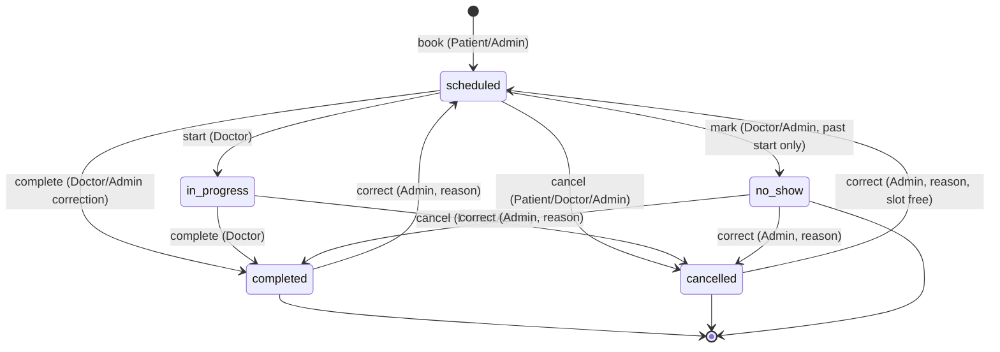
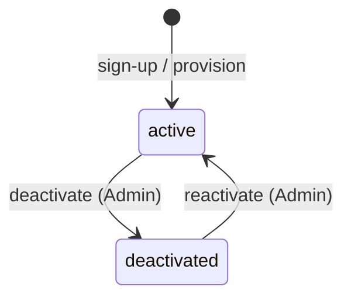

# SPEC-001 — Clinic Appointment Management System (MVP)

**Status: APPROVED — human-approved 2026-10-05**

> This document is human-gated. It authorizes nothing. No Flutter code, dependency, schema, migration
> or RLS policy may be written until this spec is approved and a `plan/` exists.

| | |
| --- | --- |
| Spec ID | SPEC-001 |
| Derived from | `intent/clinic-appointment-system.md` (Status: approved — human-approved 2026-10-05) |
| Supersedes | none |
| Spec author | analyst |
| Approved by | human-approved 2026-10-05 |

---

## 1. Purpose and scope

This spec turns the approved intent into testable requirements for the MVP: role-based auth, doctor
discovery, real-time slot viewing and booking, the appointment lifecycle, and Admin oversight with
audit — in Arabic and English, with light/dark themes, on one Flutter codebase backed only by Supabase.

**In scope**
- Patient self-registration, sign-in/out, and own-appointment management
- Doctor discovery (name search, specialty filter), profiles, and slot calendars
- Booking, cancellation, and rescheduling within policy, with double-booking prevention
- Doctor schedule dashboards, availability management, status updates, private consultation notes
- Admin provisioning, deactivation, clinic-wide schedule visibility, on-behalf-of actions, audit trail
- Arabic/English localization with RTL, system/light/dark themes, responsive layout (Web for Admin)

**Out of scope**
- Online in-app payment gateways (MVP uses pay-at-clinic cash/in-person)
- Video / telemedicine consultations
- Advanced financial & operational analytics
- Push notifications, email/SMS delivery (no FCM, no email provider — Supabase-only constraint)
- File upload / documents / avatars (Supabase Storage stays unused)
- Maps, geolocation, clinic addresses
- Multi-clinic tenancy, recurring appointments, waitlists, overbooking
- Role promotion/demotion, Doctor-initiated appointment creation, clinical record keeping
- Desktop targets; Patient/Doctor web deliverables

## 2. Terms

Terms `Patient`, `Doctor`, `Clinic Administrator`, `Doctor profile`, `Available slot`, `Appointment`,
`Role-based access` come from `docs/glossary.md` unchanged.

| Term | Definition |
| --- | --- |
| Clinic (spec-local) | The single medical facility this MVP serves. Multi-clinic support is out of scope (D-04). |
| Department (spec-local) | Organisational grouping of specialties, used for Admin calendar views (D-04). |
| Working window (spec-local) | A recurring weekly interval in which a doctor accepts bookings (D-20). |
| Break (spec-local) | A recurring weekly interval inside a working window in which a doctor is unavailable (D-20). |
| Availability exception (spec-local) | A date-specific override: a blocked period or additional hours (D-20). |
| Slot (spec-local) | A bookable interval of the doctor's slot duration derived from working windows minus breaks, exceptions, and active appointments (D-20, D-22). |
| Active appointment (spec-local) | An appointment with status `scheduled` or `in_progress`; only these occupy a slot (D-01). |
| On behalf of (spec-local) | An action an Admin performs that is attributed to the Admin, not the end user (D-30). |

## 3. Actors and permissions summary

| Actor | Can | Cannot |
| --- | --- | --- |
| Patient | Own profile (name, phone); search/filter doctors; view profiles and slots; book/cancel/reschedule own appointments within policy | See any other patient, any doctor schedule beyond published availability, or consultation notes |
| Doctor | Own profile fields; own working hours/breaks/slot duration/exceptions; own schedule; status of own appointments; own consultation notes | See other doctors' schedules, edit others' availability, access patient data outside own appointments, create appointments |
| Clinic Administrator | Provision/deactivate doctors and patients; all schedules across departments; on-behalf-of create/reschedule/cancel; clinic activity and audit trail; clinic settings | Read doctor consultation notes (D-18); change any user's role (D-13) |

## 4. Decisions Register

Every ambiguity the intent left open, resolved **explicitly**. Each `D-nn` needs human sign-off; a
rejected `D-nn` invalidates the requirements that reference it (see final report).

| ID | Question left open by intent | Decision | Rationale | Intent line resolved | Affects |
| --- | --- | --- | --- | --- | --- |
| D-01 | MVP list says Scheduled/In-Progress/Completed/Cancelled but Doctor workflow also proposes No-Show | Five statuses: `scheduled`, `in_progress`, `completed`, `no_show`, `cancelled`. `no_show` is IN scope | Both lists are author proposals; dropping `no_show` would lose the non-attendance case the Doctor workflow explicitly needs | §MVP Scope L41 + §Doctor Workflow L28 | AUTH n/a; PAT-005–008; DOC-004–007; ADM-004, ADM-008; §6 |
| D-02 | Does reschedule create a new appointment or modify? | Reschedule mutates the same record (`start_at`, `end_at`); before/after audited; no second record | Preserves identity and history; matches "reschedule" (not "rebook") in intent | §Patient Workflow L21 | PAT-008; DOC-008; ADM-005 |
| D-03 | Can terminal statuses be reversed? | Only an Admin MAY move out of `completed`/`cancelled` (to `scheduled`/`completed`/`cancelled`) with mandatory reason + audit. Patient/Doctor MUST NOT | Data-correction escape hatch without weakening lifecycle for end users | §Open Questions L65 | DOC-007; ADM-008 |
| D-04 | Single clinic or multi-clinic? | Single clinic; `departments` group `specialties` for Admin views | Intent says "the clinic", "clinic schedules" — singular; multi-tenancy never mentioned | §Admin Workflow L33 | DOC-009; ADM-003, ADM-007; §7 |
| D-05 | Timezone handling | Instants stored in UTC; one clinic-wide timezone from settings drives generation and display; no per-user timezones | Single physical clinic; per-user zones add conversion bugs with no intent basis | §Open Questions (rules pending) L66 | PAT-003; DOC-002; ADM-007; SYS-008 |
| D-06 | Specialties vs departments | One primary specialty per Doctor; specialty's department is source of truth for department membership | Intent filters by specialty and views calendars "across departments" — needs both levels with one link | §Patient Workflow L17; §Admin Workflow L33 | PAT-002; DOC-009; ADM-003 |
| D-07 | What does name search match? | Case-insensitive substring on display name only; ordered `full_name ASC`; no fuzzy/phonetic/email search | Minimal reading of "search doctors by name" | §Patient Workflow L17 | PAT-001 |
| D-08 | Which doctors are discoverable? | Only active accounts with accepting-patients flag on | Deactivated/non-accepting doctors must vanish from Patient views while Admins retain them | §Admin Workflow L32; §Role-Based Access L52 | PAT-001, PAT-004; DOC-010 |
| D-09 | Slot capacity | Exactly 1 appointment per slot | Intent's "scheduling conflicts" problem demands impossibility, not best-effort | §Problem L4; §Open Questions L66 | PAT-004; §7 |
| D-10 | Patient sign-up method | Email + password self-service; confirmation required; unconfirmed accounts may sign in but MUST NOT book/cancel/reschedule | Honors "Email/Password" proposal while preventing unverified bookings | §Patient Workflow L16; §Open Questions L64 | AUTH-001–AUTH-004 |
| D-11 | Doctor credentials | No self-registration; Admin provisions with temporary password; forced change before any Doctor screen | Direct reading of "credentials provisioned by Clinic Administrator" | §Doctor Workflow L24 | AUTH-005; ADM-002 |
| D-12 | Admin credentials | No self-registration; first Admin via service-role seed script; further Admins provisioned by an Admin | "Elevated admin credentials" with no self-service path | §Admin Workflow L31 | AUTH-006; ADM-002 |
| D-13 | Role changes | `role` immutable for all actors including Admins; promotion/demotion out of scope; separate accounts instead | Roles are fixed in intent; no promotion flow described anywhere | §Role-Based Access L52 | AUTH-007; ADM-009 |
| D-14 | Password policy | Minimum 8 characters; no complexity classes; no forced rotation | Testable minimum; complexity rules were never proposed | §Open Questions L64 | AUTH-001, AUTH-008 |
| D-15 | Session/refresh/logout | Supabase Auth JWT; SDK refreshes transparently; sign-out revokes refresh token server-side; no extra inactivity timeout | Uses Supabase Auth as constrained by AGENTS.md; nothing more proposed | §Open Questions L64 | AUTH-003 |
| D-16 | Deactivation semantics | Sets `deactivated` flag: sign-in refused, new bookings refused, removed from Patient views; existing appointments retained for Admins; NO auto-cancel; dialog shows affected future-appointment count; reactivation reverses | "View/deactivate" implies reversible admin control, not data destruction | §Admin Workflow L32 | AUTH-009; ADM-010; §6 |
| D-17 | Last-Admin protection | Deactivating the only remaining active Admin fails with a domain error | Prevents lockout; standard guard, no intent conflict | §Admin Workflow L31 | ADM-010 |
| D-18 | Admin access to notes | `notes` readable/writable by assigned Doctor only; denied to Admins, Patients, other Doctors | "Relevant patient info" for doctors vs "broader clinic management" for admins — clinical notes stay with the treating doctor | §Role-Based Access L52 | DOC-011; ADM-011; §7 |
| D-19 | "Relevant patient context" | For own appointments: patient name, phone, reason for visit, plus that patient's last 10 appointments with the same Doctor | Consultation needs contact + continuity with the same doctor; cross-doctor history not proposed | §Doctor Workflow L27 | DOC-003 |
| D-20 | Availability model | Recurring weekly working windows + recurring weekly breaks + date-specific `blocked`/`extra` exceptions; no versioned templates (history via audit) | Covers "working hours, break times, slot durations" with the simplest model that does so | §Doctor Workflow L26 | DOC-009; PAT-003 |
| D-21 | Effect of availability edits | Future generation only; existing appointments never modified/cancelled by an availability change; out-of-window bookings flagged, Admin resolves manually | Booking stability: patients must not lose appointments to a template edit | §Doctor Workflow L26 | DOC-009; ADM-005 |
| D-22 | Who computes slots | Server-side only; client MUST NOT compute or cache availability as source of truth | "Real-time slots" + identical rules for every client | §Core Value Proposition L12 | PAT-003; SYS-004 |
| D-23 | Double-booking prevention | Database-level exclusion on overlapping active intervals per doctor; app "check-then-insert" explicitly NOT the control | Only a DB constraint makes concurrency "impossible" (D-09) | §Open Questions L66 | PAT-004; §7; §11 |
| D-24 | Where rules enforced | Database triggers/functions so mobile, web, CLI, and SQL-under-a-role obey identical rules; client validation presentational only | One rule source for three clients | §Open Questions L66 | SYS-004; §11 |
| D-25 | Lead time / horizon | Patient bookings: `start_at > now + lead_time` (default 0h) and `start_at ≤ now + horizon` (default 30d); per-doctor overridable within clinic maxima | Gives "allowed timeframe" a concrete, configurable form | §Patient Workflow L21 | PAT-003, PAT-004; DOC-009 |
| D-26 | Cancellation window | Patient MAY cancel own `scheduled` appointment only when `start_at > now + 2h` (default, configurable) | Concrete "allowed timeframe" for cancel | §Patient Workflow L21 | PAT-007 |
| D-27 | Reschedule window + count | Patient MAY reschedule own `scheduled` appointment only when `start_at > now + 2h` (default) AND `reschedule_count < 2` (default, configurable) | Bounded flexibility; Admin is the escalation path beyond | §Patient Workflow L21 | PAT-008 |
| D-28 | Reschedule across doctors | Not permitted; same Doctor only; switching = cancel + new booking | Intent's reschedule reads as a time change, not a re-referral | §Patient Workflow L21 | PAT-008 |
| D-29 | Doctor cancel/reschedule | Doctor MAY cancel/reschedule own `scheduled` (and cancel own `in_progress`) with mandatory reason; patient windows do not apply to doctors | Doctor manages own schedule; reason preserves audit | §Doctor Workflow L25–28 | DOC-008 |
| D-30 | Admin override scope | Admin MAY bypass: lead time, horizon, patient windows, reschedule count, grid alignment; every action needs a mandatory reason + audit entry | "Handle adjustments or operational conflicts centrally" requires override, but bounded and attributed | §Admin Workflow L34 | ADM-004–ADM-006 |
| D-31 | Override hard limits | Admin MUST NOT bypass: double-booking exclusion, working-window containment, break/blocked-exception avoidance | Convenience never permits two overlapping bookings for one doctor | §Admin Workflow L34 | ADM-006; §7 |
| D-32 | Grid alignment | Patient bookings MUST align to the slot grid; Admin MAY create off-grid starts inside a working window (duration still equals slot duration) | Walk-ins/emergencies need flexibility; self-booking needs grid discipline | §Admin Workflow L34 | PAT-004; ADM-004 |
| D-33 | Slot duration scope | Per Doctor, default 30 min; every appointment duration MUST equal the doctor's duration, all actors included | Intent's "(e.g. 30 mins)" as default, not mandate | §Doctor Workflow L26 | PAT-004; DOC-009; ADM-004 |
| D-34 | Doctor-side creation | Doctors MUST NOT create appointments; walk-in/emergency creation is Admin-only | Intent assigns manual creation to the Admin; doctor-side creation would need unowned-patient accounts (out of scope) | §Admin Workflow L34 | DOC-012 |
| D-35 | Cancellation reason | Mandatory for every actor, every cancellation; free text ≤ 500 chars; stored on record + audit | Attribution for the lifecycle's most destructive transition | §Patient Workflow L21 | PAT-007; DOC-008; ADM-005 |
| D-36 | Reason for visit | Optional for all actors; free text ≤ 500 chars; blank/whitespace stored as null; visible to assigned Doctor and Admins; not clinical notes | "Optionally enter brief reason" + bounded length | §Patient Workflow L19 | PAT-005 |
| D-37 | `no_show` timing | Only once `start_at` has passed; before that, non-attendance = `cancelled` (or Admin override) | A future appointment cannot be a no-show yet | §Doctor Workflow L28 | DOC-006 |
| D-38 | Concurrency | Optimistic `version` per appointment; stale-version writes fail with conflict; UI refetches | Doctor and Admin may race on one status | §Open Questions L66 | DOC-004; ADM-005; §11 |
| D-39 | Clinical record | Out of scope; `notes` is a free-text Doctor-only consultation note, NOT a medical record; no diagnoses/vitals/prescriptions/documents | None proposed in intent; keeps MVP clear of medical-record obligations | §Open Questions L71 | DOC-011; ADM-011 |
| D-40 | Web decision | Web IN scope for Admin (responsive mandatory); Patient/Doctor mobile-first, web not a deliverable but not architecturally blocked | Resolves "web undecided": Admin needs full calendars on desktop; mobile-first for the other roles | §Platform Notes L58; §Open Questions L67 | SYS-002; ADM-012 |
| D-41 | Localization mechanism | `flutter_localizations` + `gen_l10n` ARB; device locale default; in-app override persisted locally per device; Arabic implies RTL | Only mechanism consistent with AGENTS.md Arabic/English | §MVP Scope L43 | SYS-005; §8 |
| D-42 | Theming | system/light/dark, default system, persisted locally per device; not synced to account | AGENTS.md light/dark with least state | AGENTS.md via §Platform Notes L55 | SYS-006; §8 |
| D-43 | Storage | Not used in MVP; no avatars/attachments/documents/uploads | "Storage only if spec confirms file needs" — no file need confirmed | §Platform Notes L59; §Open Questions L68 | SYS-003 |
| D-44 | Notifications | No delivery channels (no FCM/email — both barred by Supabase-only constraint); dashboards MUST always show current data, never a stale cache presented as current | Policy the constraint forces; freshness obligation compensates | §Open Questions L71 | SYS-007; PAT-010; DOC-013 |
| D-45 | Activity metrics | Concretely: counts by status for today + next 7 days; active doctor/patient counts; 50 most-recent privileged-action audit feed filterable by role/action/entity | Makes "clinic activity … historical logs (exact metrics pending)" testable; advanced analytics stay out | §Admin Workflow L35 | ADM-001 |

**Human approval required:** each `D-nn` above needs sign-off. A rejected `D-nn` invalidates the requirements
listed in its Affects column.

**Defaults (stated once, referenced everywhere):** clinic timezone `UTC` (set real zone before production);
slot duration `30` min; lead time `0`h; horizon `30`d; cancellation window `2`h; reschedule window `2`h;
max patient reschedules `2`; max free-text `500` chars; page size `20`; slot fetch window `30`d.

## 5. Requirements

### AUTH-001 — Patient self sign-up with email and password
**Requirement.** The system MUST allow an unauthenticated visitor to create a Patient account with a valid,
unused email and a password of at least 8 characters. The role MUST be set server-side to `patient`.
**Decisions:** D-10, D-14.

**Acceptance criteria**
1. **Given** the sign-up screen, **When** a visitor submits a valid unused email and an 8+ character password, **Then** an account with role `patient` is created and the visitor reaches the verification notice.
2. **Given** an already-registered email, **When** submitted, **Then** the request fails with a generic localized error that does not reveal registration status.
3. **Given** a password shorter than 8 characters or a syntactically invalid email, **When** submitted, **Then** submission is blocked client-side with a localized error and no request is sent.

**Negative cases.** A `role` of `doctor`/`admin` smuggled in a sign-up request is ignored; the persisted role is `patient`.

**Traces to.** `intent/clinic-appointment-system.md` §Patient Workflow — "Open app and sign up / log in (author proposed Email/Password — pending spec; auth methods remain open per approved intent)."

---

### AUTH-002 — Email confirmation gates transacting
**Requirement.** An account with an unconfirmed email MUST be able to sign in but MUST NOT book, cancel,
or reschedule. Search, profile, and slot viewing MUST remain available.
**Decisions:** D-10.

**Acceptance criteria**
1. **Given** a signed-in user with unconfirmed email, **When** they browse doctors and slots, **Then** those screens render normally.
2. **Given** the same user, **When** they attempt to confirm a booking, cancel, or reschedule, **Then** the operation is refused with a localized verify-email error and nothing is written.
3. **Given** the user completes verification, **When** they retry, **Then** the action proceeds under normal rules.

**Negative cases.** Confirmation state MUST be evaluated server-side; a client flag alone MUST NOT authorize transacting.

**Traces to.** `intent/clinic-appointment-system.md` §Open Questions — "Auth methods (Email/Password, provisioned credentials, elevated admin), session JWT/refresh/logout remain pending spec."

---

### AUTH-003 — Sign-in, session refresh, and sign-out
**Requirement.** The system MUST authenticate active users by email and password, MUST keep sessions across
restarts with transparent token refresh while a valid refresh token exists, and MUST revoke the refresh
token server-side on sign-out while clearing local authenticated state.
**Decisions:** D-15.

**Acceptance criteria**
1. **Given** valid credentials for an active account, **When** submitted, **Then** the user lands on their role's home surface.
2. **Given** a wrong password or an unknown email, **When** submitted, **Then** the identical generic localized error is shown for both cases.
3. **Given** an expired access token with a valid refresh token, **When** any data request is made, **Then** it succeeds after transparent refresh.
4. **Given** sign-out, **When** invoked (even offline), **Then** local state is cleared, the user reaches the entry screen, and a revoked token never re-authenticates.

**Negative cases.** Auth error text MUST NOT distinguish "unknown email" from "wrong password" and MUST come from the localization catalogues.

**Traces to.** `intent/clinic-appointment-system.md` §Open Questions — "Auth methods (Email/Password, provisioned credentials, elevated admin), session JWT/refresh/logout remain pending spec."

---

### AUTH-004 — Password reset via built-in recovery
**Requirement.** The system MUST offer forgot-password using the Supabase Auth built-in recovery email and
MUST require a new 8+ character password to complete the flow.
**Decisions:** D-14, D-15.

**Acceptance criteria**
1. **Given** the entry screen, **When** a reset is requested for any email, **Then** a generic success message is shown regardless of registration.
2. **Given** a valid recovery link, **When** the user sets a new 8+ character password, **Then** the password updates and the user is signed in.
3. **Given** an expired, reused, or tampered recovery token, **When** used, **Then** no password change occurs and a localized error is shown.

**Negative cases.** A new password identical to the current one MUST be refused.

**Traces to.** `intent/clinic-appointment-system.md` §Patient Workflow — "Open app and sign up / log in (author proposed Email/Password — pending spec; auth methods remain open per approved intent)."

---

### AUTH-005 — Provisioned accounts force a password change
**Requirement.** An account created by an Admin with a temporary password MUST reach only the mandatory
change-password screen until a new password is set.
**Decisions:** D-11, D-12.

**Acceptance criteria**
1. **Given** a Doctor signing in with an Admin-issued temporary password, **When** authentication succeeds, **Then** only the change-password prompt is reachable.
2. **Given** the prompt, **When** the user navigates away without completing it, **Then** no role screen is reachable.
3. **Given** a completed change, **When** finished, **Then** the temporary password no longer authenticates and the account is marked activated.

**Negative cases.** Back-navigation or deep-linking MUST NOT bypass the prompt while the flag is set.

**Traces to.** `intent/clinic-appointment-system.md` §Doctor Workflow — "Sign in with credentials provisioned by Clinic Administrator (author proposed — auth method pending spec)."

---

### AUTH-006 — Admin account provisioning and bootstrap
**Requirement.** An existing Admin MUST be able to provision further Admin accounts with temporary
passwords; the first Admin MUST be created only by a service-role seed script and MUST NOT be creatable
from the application.
**Decisions:** D-12.

**Acceptance criteria**
1. **Given** an authenticated Admin, **When** they provision an Admin with a valid unused email and temporary password, **Then** an `admin` account with forced-change flag is created and listed.
2. **Given** a deployment with no Admin, **When** the app is opened, **Then** an operator-setup notice is shown and no in-app Admin creation exists.
3. **Given** the seed script run twice, **When** executed, **Then** it is idempotent and creates no duplicate.

**Negative cases.** Provisioning an already-registered email MUST fail with a domain error and create nothing.

**Traces to.** `intent/clinic-appointment-system.md` §Clinic Administrator Workflow — "Log in with elevated admin credentials (proposed — auth pending spec)."

---

### AUTH-007 — Role immutability
**Requirement.** The `role` attribute MUST NOT be mutable by any authenticated user, including Admins,
through the client. Promotion/demotion is out of scope; separate accounts are the path.
**Decisions:** D-13.

**Acceptance criteria**
1. **Given** any authenticated user, **When** a role change is attempted on any account, **Then** the write is rejected and nothing changes.
2. **Given** any user detail screen, **When** rendered, **Then** no role-change control exists and role displays read-only.

**Negative cases.** A direct write smuggling `role` inside a profile update MUST be rejected as a whole.

**Traces to.** `intent/clinic-appointment-system.md` §Role-Based Access Notes — "Patient owns own data only; Doctor owns availability/appointments + relevant patient info; Admin has broader clinic management."

---

### AUTH-008 — Deactivated accounts cannot authenticate or transact
**Requirement.** An account flagged `deactivated` MUST NOT sign in and MUST NOT transact; an in-session user
deactivated by an Admin MUST be signed out with a localized message on the next request.
**Decisions:** D-16.

**Acceptance criteria**
1. **Given** a deactivated account, **When** sign-in is attempted, **Then** it fails with a localized deactivated-account message.
2. **Given** a signed-in user deactivated mid-session, **When** the next data request is made, **Then** it is rejected, the session is cleared, and the deactivated message is shown.
3. **Given** a deactivated Doctor, **When** a Patient searches or views slots, **Then** that Doctor is absent.

**Negative cases.** Existing appointments of deactivated accounts MUST remain retrievable by Admins.

**Traces to.** `intent/clinic-appointment-system.md` §Clinic Administrator Workflow — "Provision/manage doctor accounts (profiles, specialties) and view/deactivate patient accounts if necessary (proposed — policies pending spec)."

---

### AUTH-009 — Role-gated navigation
**Requirement.** After authentication the app MUST route each user to their role's home surface and MUST deny
cross-role routes with a localized authorization error.
**Decisions:** D-40.

**Acceptance criteria**
1. **Given** each of the three roles, **When** authentication succeeds, **Then** each lands on the correct home surface (Patient appointments / Doctor schedule / Admin dashboard).
2. **Given** any authenticated user, **When** they deep-link to another role's route, **Then** access is denied with a localized error and they return to their own home.
3. **Given** an unauthenticated user, **When** they deep-link to a protected route, **Then** they reach the entry screen and return to the route after sign-in.

**Negative cases.** Denial MUST NOT leak the target route's data.

**Traces to.** `intent/clinic-appointment-system.md` §MVP Scope — "Secure role-based auth (Patient, Doctor, Admin via Supabase Auth)."

---

### PAT-001 — Search doctors by name
**Requirement.** The system MUST let a signed-in Patient search discoverable Doctors by case-insensitive
substring on display name, ordered ascending, paginated at page size.
**Decisions:** D-07, D-08, D-48.

**Acceptance criteria**
1. **Given** the discovery screen, **When** a Patient submits "ha", **Then** only active, accepting Doctors whose name contains "ha" (any case) are listed ascending.
2. **Given** no match, **When** searched, **Then** a localized empty state is shown with no error.
3. **Given** more than a page of matches, **When** the first page loads, **Then** exactly one page renders with the total count and further pages contain no duplicates or omissions.

**Negative cases.** Deactivated or non-accepting Doctors MUST NOT appear even on exact-name match.

**Traces to.** `intent/clinic-appointment-system.md` §Patient Workflow — "Home: search doctors by name or filter by specialty."

---

### PAT-002 — Filter doctors by specialty, combinable with search
**Requirement.** The system MUST let a Patient filter by specialty (labelled in the active locale), offer
clear, and combine filter with search term as a conjunction with independent clearing.
**Decisions:** D-06.

**Acceptance criteria**
1. **Given** a selected specialty, **When** applied, **Then** only active, accepting Doctors with that primary specialty are listed.
2. **Given** a search term plus a specialty, **When** applied, **Then** only Doctors satisfying both appear.
3. **Given** both controls active, **When** the Patient clears only one, **Then** the other remains applied and results refresh without losing its value.

**Negative cases.** Specialties with no discoverable Doctor MUST still be listed but yield the empty state, not an error.

**Traces to.** `intent/clinic-appointment-system.md` §Patient Workflow — "Home: search doctors by name or filter by specialty."

---

### PAT-003 — Available slot calendar from the server
**Requirement.** The system MUST show a Doctor's bookable slots for a selectable range, fetched from the
server-side computation, excluding past/lead-time/beyond-horizon/break/blocked/occupied times, rendered in
the clinic timezone.
**Decisions:** D-20, D-22, D-25, D-05.

**Acceptance criteria**
1. **Given** a discoverable Doctor, **When** the availability view opens, **Then** at least the next 14 days each show available or fully-booked state.
2. **Given** a free day, **When** expanded, **Then** bookable times are listed in the clinic timezone with the zone labelled.
3. **Given** a fully-booked day, a day with no working hours, or a `blocked` exception date, **When** viewed, **Then** each shows its correct unavailable state with no bookable times.
4. **Given** server data changed, **When** the Patient refreshes, **Then** recomputed slots are shown; stale data MUST NOT be presented as current.

**Negative cases.** Slots inside breaks, `blocked` exceptions, the lead-time window, or beyond the horizon MUST be absent; `cancelled`/`completed` history MUST NOT suppress slots.

**Traces to.** `intent/clinic-appointment-system.md` §Patient Workflow — "Open doctor profile (qualifications + calendar of available slots) and select date/time."

---

### PAT-004 — Booking creates one scheduled appointment
**Requirement.** Confirming a valid selected slot MUST create exactly one appointment with status
`scheduled`, the Patient as owner, duration equal to the Doctor's slot duration, grid-aligned start inside
a working window, and MUST be impossible to duplicate concurrently for the same Doctor and overlapping time.
**Decisions:** D-01, D-09, D-23, D-25, D-32, D-33, D-36.

**Acceptance criteria**
1. **Given** a valid selected slot and optional reason (≤ 500 chars, blank allowed), **When** the Patient confirms, **Then** one `scheduled` appointment is created, appears in upcoming appointments, and its slot stops being offered.
2. **Given** two Patients confirming the same slot concurrently, **When** both are processed, **Then** exactly one succeeds and the loser receives a localized conflict error with a return-to-availability action.
3. **Given** an adjacent non-overlapping interval, **When** booked, **Then** both bookings are accepted.
4. **Given** a past/over-horizon/off-grid/break/out-of-window/non-discoverable-doctor start, **When** submitted, **Then** the write is rejected with a localized domain error and no record is created.

**Negative cases.** A duration differing from the Doctor's slot duration MUST be rejected for every actor.

**Traces to.** `intent/clinic-appointment-system.md` §Patient Workflow — "System reserves slot and creates appointment (author proposed status 'Scheduled' — pending spec; statuses remain open)."

---

### PAT-005 — Doctor profile view
**Requirement.** The system MUST show name, specialty, department, qualifications, and informational
consultation fee for a discoverable Doctor, with a path to slots, and MUST NOT expose contact details,
notes, or other doctors' data.
**Decisions:** D-08, D-49.

**Acceptance criteria**
1. **Given** a discoverable Doctor, **When** the Patient opens the profile, **Then** all listed fields render in the active locale with a slot-view control.
2. **Given** a Doctor deactivated after the profile was opened, **When** revisited, **Then** a localized unavailable state is shown with no booking control.
3. **Given** Arabic locale, **When** rendered, **Then** numerics follow locale conventions with RTL layout.

**Negative cases.** No Doctor contact details, internal notes, or other Doctors' data are present.

**Traces to.** `intent/clinic-appointment-system.md` §Patient Workflow — "Open doctor profile (qualifications + calendar of available slots) and select date/time."

---

### PAT-006 — Upcoming and past appointments
**Requirement.** The system MUST list the Patient's future active appointments ascending and past/terminal
appointments descending, each with doctor, specialty, time in clinic timezone, and status.
**Decisions:** D-01, D-05.

**Acceptance criteria**
1. **Given** mixed appointments, **When** the upcoming list opens, **Then** only future `scheduled`/`in_progress` appear ascending.
2. **Given** the past list, **When** opened, **Then** elapsed and terminal appointments appear descending with distinct localized status labels including `no_show`.
3. **Given** either list empty, **When** opened, **Then** a localized empty state with a next action is shown.

**Negative cases.** Another Patient's appointments MUST NOT appear under any filter.

**Traces to.** `intent/clinic-appointment-system.md` §Patient Workflow — "From profile/dashboard: view upcoming/past appointments, view details, request cancel/reschedule (author noted "if within allowed timeframe" — rules pending spec)."

---

### PAT-007 — Cancel within the allowed window with mandatory reason
**Requirement.** A Patient MUST be able to cancel their own `scheduled` appointment when `start_at` is later
than now plus the cancellation window, by supplying a non-empty reason; the slot MUST become available again
and the action MUST be audited.
**Decisions:** D-26, D-35.

**Acceptance criteria**
1. **Given** an eligible appointment, **When** the Patient cancels with a valid reason, **Then** status becomes `cancelled` with actor, timestamp, and reason recorded, the appointment moves to the past list, and the freed slot is offered again.
2. **Given** an appointment inside the window or not `scheduled`, **When** cancellation is attempted, **Then** the action is not offered and a direct attempt is rejected with a localized policy error, leaving the record unchanged.
3. **Given** an empty/whitespace or over-length reason, **When** submitted, **Then** submission is blocked with a localized validation error.

**Negative cases.** Cancelling an `in_progress`, terminal, or another Patient's appointment MUST be rejected.

**Traces to.** `intent/clinic-appointment-system.md` §Patient Workflow — "From profile/dashboard: view upcoming/past appointments, view details, request cancel/reschedule (author noted "if within allowed timeframe" — rules pending spec)."

---

### PAT-008 — Reschedule within policy, same doctor
**Requirement.** A Patient MUST be able to move their own `scheduled` appointment to another free slot of
the **same** Doctor when outside the reschedule window and under the reschedule count, mutating the same
record and incrementing the count, with before/after audited.
**Decisions:** D-02, D-27, D-28.

**Acceptance criteria**
1. **Given** an eligible appointment, **When** the Patient confirms a new free slot for the same Doctor, **Then** `start_at`/`end_at` update on the same record id, the count increments, the old slot is freed, and the new slot is taken.
2. **Given** an appointment inside the window, at the count limit, or not `scheduled`, **When** rescheduling is attempted, **Then** it is refused with a localized policy error (naming the Admin escalation path at the limit) and the record is unchanged.
3. **Given** a target slot taken concurrently, **When** confirmed, **Then** the move fails with a localized conflict error and the original time is retained.

**Negative cases.** A reschedule specifying a different Doctor MUST be rejected.

**Traces to.** `intent/clinic-appointment-system.md` §Patient Workflow — "From profile/dashboard: view upcoming/past appointments, view details, request cancel/reschedule (author noted "if within allowed timeframe" — rules pending spec)."

---

### PAT-009 — Appointment detail with permitted actions only
**Requirement.** The system MUST show the Patient's own appointment detail (doctor, specialty, date/time in
clinic timezone, status, reason) and offer only the actions currently permitted; another Patient's record
MUST be denied without rendering data.
**Decisions:** D-05, D-18.

**Acceptance criteria**
1. **Given** the Patient's own appointment, **When** opened, **Then** all fields render in the active locale and timezone with only permitted actions offered.
2. **Given** another Patient's appointment id, **When** requested, **Then** access is denied with a localized error and no data renders, including no `notes`.

**Negative cases.** Detail MUST NOT expose consultation notes to any Patient.

**Traces to.** `intent/clinic-appointment-system.md` §Patient Workflow — "From profile/dashboard: view upcoming/past appointments, view details, request cancel/reschedule (author noted "if within allowed timeframe" — rules pending spec)."

---

### PAT-010 — Current data, explicit loading/empty/error states
**Requirement.** Every Patient surface MUST re-read server state on open/refresh, MUST define loading, empty,
and error (including distinct offline) states with retry, and MUST NOT present a failed refresh's stale data
as current.
**Decisions:** D-22, D-44.

**Acceptance criteria**
1. **Given** any Patient list or detail, **When** loading, **Then** a localized indicator is shown and no partial data is presented as final.
2. **Given** a failed refresh, **When** it fails, **Then** a localized error with retry is shown (offline distinguished from server error) rather than the previous list presented as current.
3. **Given** a slot taken between view and confirm, **When** confirmed, **Then** PAT-004's conflict path applies with no success state shown.

**Negative cases.** No screen may silently succeed with no effect.

**Traces to.** `intent/clinic-appointment-system.md` §Core Value Proposition — "Replace phone/walk-in booking with digital discovery, real-time slots, and centralized schedule oversight for patients, doctors, and admins."

---

### DOC-001 — Daily and weekly schedule dashboards
**Requirement.** The system MUST show the signed-in Doctor's appointments for a selected clinic-local day
and ISO week, ordered by start ascending, each row stating time, patient name, reason (or localized
placeholder), and status, with per-day counts on the week view.
**Decisions:** D-05.

**Acceptance criteria**
1. **Given** appointments on a day, **When** the daily dashboard opens, **Then** exactly those appointments are listed ascending with all stated fields in the clinic timezone.
2. **Given** the weekly view, **When** opened, **Then** appointments are grouped into the seven clinic-local days with per-day appointment and remaining-status counts, empty days still present.
3. **Given** navigation across days, weeks, month/year boundaries, and leap days, **When** performed, **Then** the correct clinic-local dates load with data re-read from the server.

**Negative cases.** Another Doctor's appointments MUST NOT appear under any navigation or filter.

**Traces to.** `intent/clinic-appointment-system.md` §Doctor Workflow — "View daily/weekly schedule dashboard of booked appointments."

---

### DOC-002 — Schedule filtering by status
**Requirement.** The Doctor MUST be able to filter their own schedule by appointment status, with the active
filter visibly indicated and clearable.
**Decisions:** D-01.

**Acceptance criteria**
1. **Given** mixed statuses, **When** filtered to one status, **Then** only that status is listed.
2. **Given** a filter yielding no rows, **When** applied, **Then** a localized empty state is shown with the filter indicated and clearable.

**Negative cases.** Filtering MUST NOT reveal other Doctors' appointments.

**Traces to.** `intent/clinic-appointment-system.md` §Users and Stakeholders — "Doctors: need a structured dashboard to manage availability, view daily schedules, and track appointment statuses efficiently."

---

### DOC-003 — Appointment detail with own-patient context
**Requirement.** Opening an own appointment MUST show patient name, phone, reason for visit, and that
patient's last 10 appointments with the same Doctor; appointments with other Doctors and any clinical
history MUST NOT be shown.
**Decisions:** D-19, D-18, D-39.

**Acceptance criteria**
1. **Given** an own appointment, **When** opened, **Then** name, phone, reason, and at most the 10 most recent same-doctor appointments (date + status + reason) are shown.
2. **Given** another Doctor's appointment id, **When** requested, **Then** access is denied with a localized error and nothing renders.

**Negative cases.** No clinical history, vitals, prescriptions, or documents are shown — none exist in MVP.

**Traces to.** `intent/clinic-appointment-system.md` §Doctor Workflow — "Open appointment to see relevant patient context for consultation (exact fields pending spec)."

---

### DOC-004 — Start progress (scheduled → in_progress)
**Requirement.** A Doctor MUST be able to move an own `scheduled` appointment to `in_progress`, with
optimistic-concurrency protection and audit.
**Decisions:** D-01, D-38.

**Acceptance criteria**
1. **Given** an own `scheduled` appointment, **When** the Doctor starts it, **Then** status becomes `in_progress` with an audit entry recording actor and prior status.
2. **Given** a concurrent write with a stale version, **When** submitted, **Then** it fails with a conflict error prompting refresh, and the losing write changes nothing.

**Negative cases.** Starting another Doctor's appointment MUST be rejected.

**Traces to.** `intent/clinic-appointment-system.md` §Doctor Workflow — "Update appointment progress (author proposed In-Progress, Completed, No-Show, Cancelled — statuses pending spec)."

---

### DOC-005 — Complete appointment
**Requirement.** A Doctor MUST be able to move an own `scheduled` or `in_progress` appointment to
`completed`; a `completed` appointment MUST offer no further Doctor-side transitions.
**Decisions:** D-01.

**Acceptance criteria**
1. **Given** an own `scheduled` or `in_progress` appointment, **When** the Doctor completes it, **Then** status becomes `completed` with an audit entry.
2. **Given** a `completed` appointment, **When** viewed, **Then** no status-change control is offered to the Doctor and any direct attempt is rejected with the record unchanged.

**Negative cases.** Completing an appointment in any other status MUST be rejected.

**Traces to.** `intent/clinic-appointment-system.md` §Doctor Workflow — "Update appointment progress (author proposed In-Progress, Completed, No-Show, Cancelled — statuses pending spec)."

---

### DOC-006 — Mark no-show after start time
**Requirement.** A Doctor MUST be able to mark an own `scheduled` appointment `no_show` only once its start
has passed; only an Admin MAY later correct it.
**Decisions:** D-01, D-37, D-03.

**Acceptance criteria**
1. **Given** an own `scheduled` appointment with past `start_at`, **When** marked no-show, **Then** status becomes `no_show` with an audit entry.
2. **Given** an own `scheduled` appointment with future `start_at`, **When** marked no-show, **Then** the action is not offered and a direct attempt is rejected with a localized policy error.
3. **Given** a `no_show` appointment, **When** the Doctor attempts any change, **Then** it is rejected.

**Negative cases.** `no_show` MUST NOT be settable on non-`scheduled` appointments by a Doctor.

**Traces to.** `intent/clinic-appointment-system.md` §Doctor Workflow — "Update appointment progress (author proposed In-Progress, Completed, No-Show, Cancelled — statuses pending spec)."

---

### DOC-007 — Illegal transitions rejected, terminal states Doctor-final
**Requirement.** Any status change not in the §6 transition table MUST be rejected with prior status and
version preserved; Doctors MUST NOT reverse terminal states.
**Decisions:** D-01, D-24, D-03.

**Acceptance criteria**
1. **Given** a `completed`/`cancelled`/`no_show` appointment, **When** a Doctor attempts any change, **Then** it is rejected with a localized error naming the attempted transition, with no partial write and no version change.
2. **Given** any rejection, **When** it occurs, **Then** the UI names the failed action without exposing raw database text.

**Negative cases.** A rejected transition MUST NOT write an audit entry for a change that did not happen.

**Traces to.** `intent/clinic-appointment-system.md` §Open Questions — "Appointment statuses and lifecycle (author proposed Scheduled, In-Progress, Completed, Cancelled in MVP, plus No-Show earlier — inconsistency to resolve in spec)."

---

### DOC-008 — Doctor cancel and reschedule of own appointments
**Requirement.** A Doctor MUST be able to cancel an own `scheduled` or `in_progress` appointment and move an
own `scheduled` appointment to another free slot of their own calendar, each with a mandatory reason,
subject to the double-booking rule, with audit.
**Decisions:** D-29, D-35, D-23, D-02.

**Acceptance criteria**
1. **Given** an eligible own appointment, **When** the Doctor cancels with a non-empty reason, **Then** status becomes `cancelled` with actor/reason/timestamp recorded and the slot is freed.
2. **Given** an own `scheduled` appointment, **When** the Doctor moves it to a free own slot with a reason, **Then** the same record updates, the count increments, before/after are audited, and the Patient sees the new time on next read.
3. **Given** an overlapping target or an `in_progress` reschedule, **When** attempted, **Then** it is rejected with a localized conflict/policy error and the original time is retained.

**Negative cases.** Empty reasons MUST block submission; terminal appointments MUST NOT be cancellable by a Doctor.

**Traces to.** `intent/clinic-appointment-system.md` §Doctor Workflow — "View daily/weekly schedule dashboard of booked appointments." (schedule management) and "Update appointment progress (author proposed In-Progress, Completed, No-Show, Cancelled — statuses pending spec)."

---

### DOC-009 — Availability management (windows, breaks, duration, exceptions)
**Requirement.** A Doctor MUST be able to define recurring weekly working windows, recurring weekly breaks,
own slot duration, booking lead time/horizon within clinic maxima, and date-specific `blocked`/`extra`
exceptions; all changes MUST affect only future generation and MUST NEVER modify existing appointments.
**Decisions:** D-20, D-21, D-33, D-25.

**Acceptance criteria**
1. **Given** a window 09:00–17:00 with break 13:00–14:00 and 30-minute duration, **When** slots generate, **Then** starts are on the grid, none overlap the break, and no start would end after the window; a non-multiple remainder yields no trailing slot.
2. **Given** overlapping/zero-length windows or breaks, or an invalid duration/lead/horizon, **When** saved, **Then** saving is blocked with a localized validation error and existing data is unchanged.
3. **Given** a `blocked` whole-day exception, **When** generating that date, **Then** no slots are offered regardless of template; an `extra` evening exception on a closed day offers only that range.
4. **Given** booked appointments, **When** windows narrow, breaks are deleted, or duration changes, **Then** every existing appointment remains unchanged on the schedule (out-of-window ones flagged but retained).

**Negative cases.** A break extending outside every window MUST save harmlessly (no effect outside windows).

**Traces to.** `intent/clinic-appointment-system.md` §Doctor Workflow — "Define/adjust working hours, break times, slot durations (e.g. 30 mins) to reflect open slots (proposed — rules pending spec)."

---

### DOC-010 — Accepting-patients toggle
**Requirement.** A Doctor MUST be able to stop and resume accepting new bookings without losing existing
appointments.
**Decisions:** D-08.

**Acceptance criteria**
1. **Given** the toggle set to off, **When** saved, **Then** the Doctor vanishes from Patient search/profile/slots, new bookings are rejected, and existing appointments remain on the schedule.
2. **Given** the toggle set back on, **When** saved, **Then** discoverability and bookability resume immediately on next read.

**Negative cases.** Toggling MUST NOT cancel, move, or hide existing appointments from the Doctor's own schedule.

**Traces to.** `intent/clinic-appointment-system.md` §Users and Stakeholders — "Doctors: need a structured dashboard to manage availability, view daily schedules, and track appointment statuses efficiently."

---

### DOC-011 — Private consultation notes
**Requirement.** A Doctor MUST be able to write and read free-text notes (≤ 500 chars) on own appointments;
no other role and no other Doctor MUST receive the `notes` value under any query.
**Decisions:** D-18, D-39.

**Acceptance criteria**
1. **Given** an own appointment, **When** the Doctor saves notes, **Then** they persist and render on reopening.
2. **Given** an Admin, Patient, or other-Doctor session, **When** any appointment payload is read, **Then** the `notes` value is absent entirely (no field, placeholder, or length).
3. **Given** a non-owner write targeting `notes`, **When** attempted, **Then** it is rejected.

**Negative cases.** Over-length notes MUST be blocked with a localized validation error.

**Traces to.** `intent/clinic-appointment-system.md` §Role-Based Access Notes — "Patient owns own data only; Doctor owns availability/appointments + relevant patient info; Admin has broader clinic management."

---

### DOC-012 — No Doctor-side appointment creation
**Requirement.** Doctor surfaces MUST NOT offer appointment creation, and Doctor-issued inserts MUST be
rejected.
**Decisions:** D-34, D-51.

**Acceptance criteria**
1. **Given** any Doctor screen, **When** inspected, **Then** no create/walk-in control exists.
2. **Given** a Doctor session, **When** an appointment insert is attempted, **Then** it is rejected with a permission error and no record is created.

**Negative cases.** None — the absence is total.

**Traces to.** `intent/clinic-appointment-system.md` §Clinic Administrator Workflow — "Manually create/reschedule/cancel on behalf of patients/doctors for walk-ins, emergencies, or conflicts (override rules pending spec)."

---

### DOC-013 — Doctor loading, empty, and error states
**Requirement.** Every Doctor surface MUST define loading, empty (showing the day's working hours), and
error-with-retry states; failed availability saves MUST retain the Doctor's input.
**Decisions:** D-44.

**Acceptance criteria**
1. **Given** an in-flight schedule load, **When** waiting, **Then** a localized indicator is shown.
2. **Given** an empty day, **When** viewed, **Then** a localized empty state plus the day's working hours is shown.
3. **Given** a failed load or save, **When** it fails, **Then** a localized error with retry is shown, the form retains input, and the app stays interactive.

**Negative cases.** Failed saves MUST NOT clear the form or partially persist.

**Traces to.** `intent/clinic-appointment-system.md` §Users and Stakeholders — "Doctors: need a structured dashboard to manage availability, view daily schedules, and track appointment statuses efficiently."

---

### ADM-001 — Clinic activity dashboard (bounded metrics)
**Requirement.** The Admin dashboard MUST show appointment counts by status for today and the next 7 days,
active doctor and patient counts, and the 50 most recent privileged actions — and MUST NOT show financial
analytics.
**Decisions:** D-46.

**Acceptance criteria**
1. **Given** an active Admin, **When** the dashboard loads, **Then** today's per-status counts, next-7-days per-status counts, active doctor/patient counts, and the 50 most recent privileged actions (reverse-chronological) are shown.
2. **Given** a failing metrics query, **When** it fails, **Then** that panel shows a localized error with retry while the rest remains usable.

**Negative cases.** No revenue, fee-total, or financial breakdown is shown anywhere.

**Traces to.** `intent/clinic-appointment-system.md` §Clinic Administrator Workflow — "Track clinic activity, appointment statuses, and historical logs (exact metrics pending spec)."

---

### ADM-002 — Doctor provisioning and profile management
**Requirement.** An Admin MUST be able to provision Doctor accounts (email + temporary password, forced
change) and manage display name, phone, specialty, qualifications, bio, experience, fee, and
accepting-patients flag; specialty changes MUST NOT recategorise existing appointments.
**Decisions:** D-11, D-06, D-49.

**Acceptance criteria**
1. **Given** a valid unused email and 8+ character temporary password, **When** submitted, **Then** an active Doctor with forced-change flag is created and listed.
2. **Given** a specialty change on a Doctor with future appointments, **When** saved, **Then** existing appointments keep their stored specialty/department snapshot and are not cancelled.
3. **Given** a duplicate email, invalid fee, or short temporary password, **When** submitted, **Then** the operation fails with a localized domain/validation error and nothing is created or changed.

**Negative cases.** Provisioning MUST NOT accept a duplicate email or create a second account.

**Traces to.** `intent/clinic-appointment-system.md` §Clinic Administrator Workflow — "Provision/manage doctor accounts (profiles, specialties) and view/deactivate patient accounts if necessary (proposed — policies pending spec)."

---

### ADM-003 — Specialty and department catalogue
**Requirement.** An Admin MUST be able to create/rename/deactivate specialties and view departments; deleting
a specialty in use MUST be blocked; deactivation MUST hide it from Patient filters while retaining existing
Doctors.
**Decisions:** D-06.

**Acceptance criteria**
1. **Given** a new specialty with unique code and localized names, **When** created, **Then** it is selectable for Doctors and appears in the Patient filter in the active locale.
2. **Given** a specialty assigned to ≥ 1 Doctor, **When** deletion is attempted, **Then** it is blocked with a localized error directing reassignment first.
3. **Given** deactivation, **When** applied, **Then** the specialty leaves the Patient filter while existing Doctors keep it and stay visible to Admins.

**Negative cases.** Duplicate specialty codes MUST be rejected.

**Traces to.** `intent/clinic-appointment-system.md` §Clinic Administrator Workflow — "Provision/manage doctor accounts (profiles, specialties) and view/deactivate patient accounts if necessary (proposed — policies pending spec)."

---

### ADM-004 — Create appointment on behalf
**Requirement.** An Admin MUST be able to create an appointment for any existing patient with any doctor,
optionally off-grid inside a working window, with a mandatory reason, subject to the hard limits in D-31.
**Decisions:** D-30, D-31, D-32, D-33, D-35.

**Acceptance criteria**
1. **Given** an existing patient, a doctor, a free in-window time, and a non-empty reason, **When** submitted, **Then** one `scheduled` appointment is created attributed to the Admin with duration equal to the slot duration, and the audit records any bypassed rules.
2. **Given** an off-grid start inside a working window, **When** submitted, **Then** creation succeeds.
3. **Given** a time outside every window, overlapping a break/blocked exception, overlapping an active booking, or in the past (without explicit historical-entry choice), **When** submitted, **Then** creation is rejected with a localized domain/conflict error and nothing is written.
4. **Given** an empty reason, **When** submitted, **Then** submission is blocked with a localized validation error.

**Negative cases.** Bypassing the double-booking rule MUST be impossible even for Admins.

**Traces to.** `intent/clinic-appointment-system.md` §Clinic Administrator Workflow — "Manually create/reschedule/cancel on behalf of patients/doctors for walk-ins, emergencies, or conflicts (override rules pending spec)."

---

### ADM-005 — Reschedule and cancel on behalf
**Requirement.** An Admin MUST be able to move or cancel any non-terminal appointment, bypassing patient and
doctor time windows (but never the hard limits), with a mandatory reason, mutating the same record on move,
with full audit.
**Decisions:** D-30, D-31, D-02, D-35, D-38.

**Acceptance criteria**
1. **Given** any `scheduled`/`in_progress` appointment, **When** the Admin cancels with a reason, **Then** status becomes `cancelled` with actor/reason/timestamp, the slot is freed, and the override is audited.
2. **Given** any non-terminal appointment, **When** the Admin moves it to a free time with a reason, **Then** the same record updates, the count increments, before/after plus bypassed rules are audited, and both Patient and Doctor see the new time on next read.
3. **Given** a terminal appointment, **When** moved or cancelled as such, **Then** it is rejected (correction flow ADM-008 applies instead).
4. **Given** an overlapping target, **When** submitted, **Then** it is rejected with a localized conflict error.

**Negative cases.** Stale-version writes MUST fail with conflict per D-38.

**Traces to.** `intent/clinic-appointment-system.md` §Clinic Administrator Workflow — "Manually create/reschedule/cancel on behalf of patients/doctors for walk-ins, emergencies, or conflicts (override rules pending spec)."

---

### ADM-006 — Override boundaries
**Requirement.** Admin override MUST be able to bypass lead time, horizon, patient windows, reschedule count,
and grid alignment, and MUST NOT be able to bypass the double-booking exclusion, working-window
containment, or break/blocked-exception avoidance; every override MUST record which rules were bypassed.
**Decisions:** D-30, D-31.

**Acceptance criteria**
1. **Given** a 45-day-out time inside a valid window with horizon 30d, **When** an Admin books it with a reason, **Then** it succeeds and the audit flags the horizon bypass.
2. **Given** any change producing an overlapping active booking for one doctor, **When** attempted by an Admin, **Then** it is rejected with a conflict error and nothing is written.
3. **Given** a date with no working window, **When** an Admin attempts booking, **Then** it is rejected with a message explaining a window must exist first.

**Negative cases.** An override audit entry MUST list bypassed rules; entries without reason MUST NOT exist.

**Traces to.** `intent/clinic-appointment-system.md` §Open Questions — "Cancellation/rescheduling/timeframe rules, override rules, and double-booking prevention remain pending spec."

---

### ADM-007 — Clinic-wide schedule visibility
**Requirement.** The Admin MUST be able to view appointments across all doctors and departments for a day,
week, or range, grouped by department then start ascending, filtered by doctor/department/status/date, and
paginated.
**Decisions:** D-04, D-05, D-48.

**Acceptance criteria**
1. **Given** a selected day, **When** the clinic calendar opens, **Then** all appointments that day are listed grouped by department, ordered by start ascending.
2. **Given** doctor, department, multi-status, or range filters, **When** applied, **Then** the conjunction is listed with filters shown as removable chips and paginated results with totals.

**Negative cases.** Consultation `notes` MUST NOT appear in any clinic-wide view.

**Traces to.** `intent/clinic-appointment-system.md` §Clinic Administrator Workflow — "Full visibility over clinic schedules, working hours, and calendars across departments."

---

### ADM-008 — Terminal-state corrections
**Requirement.** An Admin MUST be able to move an appointment out of a terminal state to correct data, with a
mandatory reason; corrections that would create an overlap MUST be rejected.
**Decisions:** D-03.

**Acceptance criteria**
1. **Given** a `completed` appointment, **When** an Admin corrects it to `scheduled` with a reason, **Then** it succeeds with an audit entry.
2. **Given** a `cancelled` appointment corrected to `scheduled`, **When** the slot is taken, **Then** it is rejected with a conflict error.
3. **Given** a `no_show` appointment, **When** corrected to `completed`/`cancelled` with a reason, **Then** it succeeds with an audit entry.

**Negative cases.** Corrections without a reason MUST be blocked; Patients/Doctors MUST NOT have this path.

**Traces to.** `intent/clinic-appointment-system.md` §Open Questions — "Appointment statuses and lifecycle (author proposed Scheduled, In-Progress, Completed, Cancelled in MVP, plus No-Show earlier — inconsistency to resolve in spec)."

---

### ADM-009 — Deactivate and reactivate with impact warning
**Requirement.** An Admin MUST be able to deactivate/reactivate Doctor and Patient accounts; deactivation
MUST NOT cancel appointments; the dialog MUST show the affected future-appointment count and earliest date
and require explicit confirmation; deactivating the last active Admin MUST fail.
**Decisions:** D-16, D-17.

**Acceptance criteria**
1. **Given** an account with 5 future non-cancelled appointments, **When** the dialog opens, **Then** count 5 and the earliest date are shown before any change.
2. **Given** confirmation, **When** applied, **Then** sign-in and new bookings are refused, Patient views exclude the account, all appointments are retained for Admins, and reactivation reverses everything without touching appointments.
3. **Given** the only remaining active Admin, **When** deactivation is attempted on it, **Then** it fails with a domain error naming the last-admin rule and nothing changes.

**Negative cases.** Dismissing the dialog MUST apply no change.

**Traces to.** `intent/clinic-appointment-system.md` §Clinic Administrator Workflow — "Provision/manage doctor accounts (profiles, specialties) and view/deactivate patient accounts if necessary (proposed — policies pending spec)."

---

### ADM-010 — Audit viewer and clinic settings
**Requirement.** An Admin MUST be able to read the append-only audit trail (filterable, paginated
newest-first, never editable) and MUST be able to view/update clinic-wide defaults; non-Admin writes to
settings MUST be rejected.
**Decisions:** D-47, D-46, D-48, D-05, D-25, D-26, D-27, D-33.

**Acceptance criteria**
1. **Given** the audit view, **When** opened, **Then** entries list actor, role, action, entity, reason, and timestamp reverse-chronologically with role/action/entity/actor/date-range filters and pagination; no edit/delete control exists and direct mutation is rejected.
2. **Given** a timezone change, **When** saved, **Then** generation and display use the new zone from the next query while stored instants are unchanged.
3. **Given** an invalid setting (negative lead time, zero horizon, page size above 200), **When** submitted, **Then** saving is blocked with a localized validation error.
4. **Given** a default-slot-duration change, **When** saved, **Then** only doctors without an explicit duration are affected.

**Negative cases.** Any `UPDATE`/`DELETE` against an audit entry from any role MUST be rejected.

**Traces to.** `intent/clinic-appointment-system.md` §Clinic Administrator Workflow — "Track clinic activity, appointment statuses, and historical logs (exact metrics pending spec)."

---

### ADM-011 — Admin never sees consultation notes
**Requirement.** The `notes` value MUST be absent from every Admin payload, view, and export; Admin writes
targeting `notes` MUST be rejected; the UI MUST NOT imply access.
**Decisions:** D-18, D-39.

**Acceptance criteria**
1. **Given** any Admin query, view, or export over appointments, **When** executed, **Then** no `notes` field, placeholder, or character count is present.
2. **Given** an Admin write targeting `notes`, **When** attempted, **Then** it is rejected with nothing changed.

**Negative cases.** Reason-for-visit MUST remain visible to Admins (it is not notes).

**Traces to.** `intent/clinic-appointment-system.md` §Role-Based Access Notes — "Patient owns own data only; Doctor owns availability/appointments + relevant patient info; Admin has broader clinic management."

---

### ADM-012 — Responsive Admin on Web and mobile
**Requirement.** The Admin surface MUST be fully operable on Flutter Web across 390px–1440px+ viewports (no
overflow, no page-level horizontal scroll, tables collapsing to non-truncating representations) and in both
locales with correct RTL mirroring.
**Decisions:** D-40, D-41.

**Acceptance criteria**
1. **Given** viewports 1440×900, 1024×768, and 390×844, **When** dashboard, calendar, user lists, and audit render in each locale, **Then** all content is reachable with no layout overflow and mirrored correctly in Arabic.
2. **Given** light, dark, and system themes, **When** each Admin screen renders, **Then** it is legible with sufficient contrast.

**Negative cases.** No Admin action may be reachable only at one viewport size.

**Traces to.** `intent/clinic-appointment-system.md` §Platform and Technical Notes — "MVP: Mobile (Android & iOS) primary for Patients/Doctors; Web (Flutter Web) primary for Admins, optionally Patients/Doctors — note: web for admin differs from approved intent where web was undecided."

---

### SYS-001 — Single codebase, Supabase-only backend, no external services
**Requirement.** The system MUST be one Flutter codebase for all roles with backend access only via the
Supabase Flutter SDK (Auth, PostgreSQL); FCM, email providers, Maps, payment gateways, and any other
external service MUST NOT be introduced; Storage MUST stay unused.
**Decisions:** D-43, D-44, D-45, D-49, D-50.

**Acceptance criteria**
1. **Given** the codebase, **When** inspected, **Then** one Flutter project serves all three roles with no non-Supabase backend client.
2. **Given** any user flow, **When** executed, **Then** no FCM token, email dispatch, map tile, or payment call occurs.

**Negative cases.** Adding any of the listed integrations without an approved spec amendment MUST fail review.

**Traces to.** `intent/clinic-appointment-system.md` §Platform and Technical Notes — "Backend: Supabase (Auth, PostgreSQL, Storage) — Storage only if spec confirms file needs." and §Open Questions — "Storage need, FCM push, Maps, email provider, and future Stripe gateway are beyond Supabase-only constraint — need spec approval."

---

### SYS-002 — Platform targets
**Requirement.** Patient and Doctor MUST ship on Android and iOS; Admin MUST ship on Web plus Android/iOS;
desktop targets MUST NOT ship; Patient/Doctor web builds MUST NOT be MVP deliverables.
**Decisions:** D-40.

**Acceptance criteria**
1. **Given** each role, **When** delivered, **Then** the required platforms are present and the excluded ones are absent from release artifacts.
2. **Given** the architecture, **When** inspected, **Then** a future Patient/Doctor web build is not structurally blocked.

**Negative cases.** No desktop build artifacts are produced.

**Traces to.** `intent/clinic-appointment-system.md` §Platform and Technical Notes — "MVP: Mobile (Android & iOS) primary for Patients/Doctors; Web (Flutter Web) primary for Admins, optionally Patients/Doctors — note: web for admin differs from approved intent where web was undecided."

---

### SYS-003 — Architecture and state management
**Requirement.** The system MUST use Bloc/Cubit only for state, Clean Architecture with Repository Pattern
and dependency injection, SOLID testable business logic; setState-as-state-management, Riverpod, Provider,
and GetX for state MUST NOT be used.
**Decisions:** none (AGENTS.md binding).

**Acceptance criteria**
1. **Given** the codebase, **When** inspected, **Then** all shared state flows through Bloc/Cubit with repositories behind interfaces and injected dependencies.
2. **Given** any feature, **When** inspected, **Then** business logic resides in testable units separable from widgets.

**Negative cases.** Any non-Bloc global state solution MUST fail review.

**Traces to.** `intent/clinic-appointment-system.md` §Platform and Technical Notes — "Architecture: Clean Architecture + Bloc/Cubit + Repository Pattern (aligns with AGENTS.md)."

---

### SYS-004 — Single rule source, server-computed availability
**Requirement.** Booking, cancellation, rescheduling, and availability rules MUST be enforced database-side so
every client obeys identical rules; slots MUST be computed server-side; client validation is presentational
only.
**Decisions:** D-22, D-24.

**Acceptance criteria**
1. **Given** identical operations via mobile, web, CLI, or SQL-under-a-role, **When** executed, **Then** identical allow/deny outcomes result.
2. **Given** the client, **When** inspected, **Then** no independent availability computation exists as a source of truth.

**Negative cases.** A rule enforced only in the client MUST fail review.

**Traces to.** `intent/clinic-appointment-system.md` §Core Value Proposition — "Replace phone/walk-in booking with digital discovery, real-time slots, and centralized schedule oversight for patients, doctors, and admins."

---

### SYS-005 — Arabic/English localization with RTL
**Requirement.** The system MUST ship Arabic and English via `flutter_localizations` + `gen_l10n` ARB files,
default to the device locale, offer a locally-persisted in-app override, render Arabic fully RTL, and MUST
NOT sync language to the account.
**Decisions:** D-41.

**Acceptance criteria**
1. **Given** Arabic selected, **When** any screen renders, **Then** all text comes from the Arabic catalogue with RTL mirroring and no untranslated fallback.
2. **Given** English selected, **When** rendered, **Then** English LTR applies.
3. **Given** no explicit choice, **When** launched, **Then** the device locale applies; the choice persists across restarts on the device only.

**Negative cases.** No screen may show a raw message key or mixed-direction clipping.

**Traces to.** `intent/clinic-appointment-system.md` §MVP Scope — "Multi-language Localization in scope (Arabic/English per AGENTS.md)." and §Open Questions — "Resolved per author 2026-10-04: Multi-language Localization is in scope for MVP (aligns with AGENTS.md Arabic/English)."

---

### SYS-006 — Theming and responsive layout
**Requirement.** The system MUST offer system/light/dark themes (default system, persisted locally, not
synced) and MUST lay out responsively from 360px phones to desktop web widths with no overflow.
**Decisions:** D-42, D-40.

**Acceptance criteria**
1. **Given** each theme, **When** any screen renders, **Then** it is legible with sufficient contrast and the choice persists across restarts.
2. **Given** 360px, 768px, 1024px, and 1440px widths, **When** key screens render in each locale, **Then** no layout overflow occurs.

**Negative cases.** Theme MUST NOT be stored on the account or require sign-in to persist.

**Traces to.** `intent/clinic-appointment-system.md` §Platform and Technical Notes — "Only constraints already approved in AGENTS.md; nothing new added here." (AGENTS.md: Arabic/English localization, light/dark themes, responsive layout.)

---

### SYS-007 — Freshness without push
**Requirement.** With no delivery channels in MVP, every dashboard and list MUST re-read server state on
open/refresh and MUST report refresh failures instead of presenting stale data as current.
**Decisions:** D-44.

**Acceptance criteria**
1. **Given** any dashboard opened or refreshed, **When** loaded, **Then** data is re-read from the server.
2. **Given** a refresh failure, **When** it fails, **Then** a localized error with retry is shown rather than the previous data presented as current.

**Negative cases.** No badge, toast, or cache may imply a state the server does not confirm.

**Traces to.** `intent/clinic-appointment-system.md` §Open Questions — "Notifications policy, security policies beyond role-level, and analytics/telemedicine scope pending spec."

---

### SYS-008 — Authorization failures and error hygiene
**Requirement.** Every rejected request MUST yield a localized, user-readable error state; the app MUST NOT
crash, MUST NOT surface raw database text, and MUST leave on-screen data unchanged.
**Decisions:** D-24.

**Acceptance criteria**
1. **Given** any denied operation, **When** it occurs, **Then** a localized message naming the failed action is shown with no stack trace or SQL text, and displayed data is unchanged.
2. **Given** an unexpected error, **When** it occurs, **Then** a generic localized error plus a locally logged correlation id is shown.

**Negative cases.** Silent success-with-no-effect MUST NOT occur.

**Traces to.** `intent/clinic-appointment-system.md` §Open Questions — "Notifications policy, security policies beyond role-level, and analytics/telemedicine scope pending spec."

---

## 6. State machines

### 6.1 Appointment lifecycle

| From → To | Guard | Allowed roles | Side effects |
| --- | --- | --- | --- |
| `[*]` → `scheduled` | Valid slot per PAT-004 / ADM-004 | Patient (own, grid-aligned), Admin | Count slot taken; audit entry |
| `scheduled` → `in_progress` | Own appointment; version match | Doctor | Audit entry |
| `scheduled` → `completed` | Own appointment (back-office entry) | Doctor, Admin (correction w/ reason) | Slot freed for future generation; audit |
| `in_progress` → `completed` | Own appointment | Doctor | Audit entry |
| `scheduled` → `cancelled` | Patient: outside window (D-26); Doctor/Admin: mandatory reason | Patient (own), Doctor (own), Admin | Reason + actor + timestamp; slot freed; audit |
| `in_progress` → `cancelled` | Mandatory reason | Doctor (own), Admin | Same as above; audit |
| `scheduled` → `no_show` | `start_at` has passed (D-37) | Doctor (own), Admin | Audit entry |
| `completed` → `scheduled` | Mandatory reason (D-03) | Admin | Audit entry; slot re-checked |
| `cancelled` → `scheduled` | Mandatory reason + slot still free | Admin | Audit entry |
| `no_show` → `completed`/`cancelled` | Mandatory reason | Admin | Audit entry |

Terminal states: `completed`, `cancelled`, `no_show` (Doctor/Patient-final; Admin-correctable per D-03).

### 6.2 Account lifecycle

| From → To | Guard | Allowed roles | Side effects |
| --- | --- | --- | --- |
| `[*]` → `active` | Valid email + password / provision | Visitor (Patient only), Admin, seed script (first Admin) | Role set server-side; forced-change flag for provisioned |
| `active` → `deactivated` | Impact warning confirmed; not last Admin | Admin | Sign-in/transacting refused; appointments retained |
| `deactivated` → `active` | Admin action | Admin | Sign-in/transacting restored; appointments untouched |

## 7. Authorization matrix

Logical collections × role × operation. Enforced database-side; client hiding is never the control (D-24).
Denials MUST be tested (§11).

| Collection | Patient | Doctor | Admin |
| --- | --- | --- | --- |
| Own profile (`profiles` self row) | SELECT; UPDATE name/phone only | SELECT; UPDATE own allowed fields | SELECT all; UPDATE all except `role` |
| Other profiles | No access (Doctors visible only via published profile projection) | SELECT patients attached to own appointments only (D-19 fields) | SELECT all; no `role` writes |
| Doctor professional data | SELECT published fields of discoverable doctors only | SELECT/UPDATE own only | SELECT/UPDATE all (except notes) |
| Specialties / departments | SELECT active only | SELECT all | SELECT/INSERT/UPDATE all; DELETE specialty only when unused |
| Own availability (windows/breaks/exceptions) | No access | SELECT/INSERT/UPDATE/DELETE own only | SELECT all; UPDATE clinic-wide only via settings, not per-doctor rows |
| Appointments | SELECT own; INSERT own per PAT-004; UPDATE own per PAT-007/PAT-008 only | SELECT own; UPDATE status/notes/reschedule per DOC-004–DOC-008/DOC-011; NO INSERT | SELECT all (minus `notes`); INSERT/UPDATE per ADM-004–ADM-006/ADM-008 |
| Appointment `notes` value | Never returned | Assigned Doctor only | Never returned; writes rejected |
| Audit trail | No access | No access | SELECT only; UPDATE/DELETE rejected for all roles |
| Clinic settings | SELECT (read limits/timezone) | SELECT | SELECT/UPDATE |

## 8. Non-functional requirements

| ID | Category | Requirement | How verified |
| --- | --- | --- | --- |
| NFR-001 | Performance | Slot calendar for a 30-day window MUST render in under 3 s on a mid-range device on 4G | Timed integration test |
| NFR-002 | Performance | Search keystrokes MUST be debounced; empty queries MUST issue no request | Widget test with fake clock |
| NFR-003 | Responsiveness | 360px–1440px+ with no overflow in both locales (see SYS-006, ADM-012) | Widget tests at 4 widths × 2 locales |
| NFR-004 | Accessibility | Interactive elements MUST expose semantics labels in the active locale; contrast MUST meet WCAG AA in both themes | Semantics + contrast widget tests |
| NFR-005 | Localization | 100% of user-visible strings from ARB catalogues; zero raw keys in either locale | Catalogue-completeness test + RTL widget tests |
| NFR-006 | Theming | All screens legible in system/light/dark | Themed widget tests |
| NFR-007 | Offline/errors | No-network MUST surface a distinct offline error with retry; failures MUST NOT present stale data as current | Integration tests with network cut |
| NFR-008 | Audit | Every privileged mutation MUST write an append-only entry with actor/role/action/entity/before-after/reason/timestamp | Integration tests per mutation |
| NFR-009 | Security | Auth errors MUST NOT enumerate accounts; authorization MUST be database-enforced with denial tests | Negative integration tests |
| NFR-010 | Data integrity | Concurrent same-slot bookings MUST yield exactly one success; stale-version writes MUST fail | Concurrency integration tests |
| NFR-011 | Time correctness | All instants UTC; generation/display in the configured clinic zone; DST transitions MUST NOT duplicate or drop slots | Unit tests over DST boundary fixtures |

## 9. Requirement ID scheme

| Prefix | Domain | Count in this spec |
| --- | --- | --- |
| `AUTH-*` | Authentication, session, accounts | 9 |
| `PAT-*` | Patient actor | 10 |
| `DOC-*` | Doctor actor | 13 |
| `ADM-*` | Admin actor | 12 |
| `SYS-*` | Cross-cutting | 8 |
| `NFR-*` | Non-functional | 11 |
| `D-nn` | Spec decisions | 45 |
| `Q-nn` | Blocking questions | 5 |

IDs are **stable**. Never renumber or reuse. Retired IDs stay with a `RETIRED` marker and a pointer
to the superseding ID.

## 10. Traceability matrix

Forward: every intent line → requirement IDs. Reverse follows in the second table.

| Intent section | Intent line (verbatim, trimmed) | Requirement IDs |
| --- | --- | --- |
| §Problem L4 | "Inefficiency, manual overhead, and scheduling conflicts from traditional clinic booking methods (such as phone calls or walk-ins)." | PAT-004, PAT-010, SYS-004, NFR-010 |
| §Users L7 | "Patients: need an effortless, digital way to discover doctors, view real-time available time slots, and schedule or manage appointments anytime." | PAT-001–PAT-010 |
| §Users L8 | "Doctors: need a structured dashboard to manage availability, view daily schedules, and track appointment statuses efficiently." | DOC-001–DOC-003, DOC-009, DOC-010, DOC-013 |
| §Users L9 | "Clinic Administrators: require full oversight to manage users (doctors and patients), control clinic schedules, and handle adjustments or operational conflicts centrally." | ADM-001–ADM-010, ADM-012 |
| §Value L12 | "Replace phone/walk-in booking with digital discovery, real-time slots, and centralized schedule oversight for patients, doctors, and admins." | PAT-001–PAT-004, PAT-010, SYS-004, SYS-007 |
| §Patient L16 | "Open app and sign up / log in (author proposed Email/Password — pending spec; auth methods remain open per approved intent)." | AUTH-001–AUTH-004 |
| §Patient L17 | "Home: search doctors by name or filter by specialty." | PAT-001, PAT-002 |
| §Patient L18 | "Open doctor profile (qualifications + calendar of available slots) and select date/time." | PAT-003, PAT-005 |
| §Patient L19 | "Optionally enter brief reason for visit and confirm booking." | PAT-004 |
| §Patient L20 | "System reserves slot and creates appointment (author proposed status 'Scheduled' — pending spec; statuses remain open)." | PAT-004, §6.1 |
| §Patient L21 | "From profile/dashboard: view upcoming/past appointments, view details, request cancel/reschedule (author noted "if within allowed timeframe" — rules pending spec)." | PAT-006–PAT-009 |
| §Doctor L24 | "Sign in with credentials provisioned by Clinic Administrator (author proposed — auth method pending spec)." | AUTH-005, AUTH-009 |
| §Doctor L25 | "View daily/weekly schedule dashboard of booked appointments." | DOC-001, DOC-002, DOC-008 |
| §Doctor L26 | "Define/adjust working hours, break times, slot durations (e.g. 30 mins) to reflect open slots (proposed — rules pending spec)." | DOC-009, DOC-010 |
| §Doctor L27 | "Open appointment to see relevant patient context for consultation (exact fields pending spec)." | DOC-003 |
| §Doctor L28 | "Update appointment progress (author proposed In-Progress, Completed, No-Show, Cancelled — statuses pending spec)." | DOC-004–DOC-008, §6.1 |
| §Admin L31 | "Log in with elevated admin credentials (proposed — auth pending spec)." | AUTH-006, AUTH-009 |
| §Admin L32 | "Provision/manage doctor accounts (profiles, specialties) and view/deactivate patient accounts if necessary (proposed — policies pending spec)." | ADM-002, ADM-003, ADM-009, AUTH-008 |
| §Admin L33 | "Full visibility over clinic schedules, working hours, and calendars across departments." | ADM-007 |
| §Admin L34 | "Manually create/reschedule/cancel on behalf of patients/doctors for walk-ins, emergencies, or conflicts (override rules pending spec)." | ADM-004–ADM-006, DOC-012 |
| §Admin L35 | "Track clinic activity, appointment statuses, and historical logs (exact metrics pending spec)." | ADM-001, ADM-010 |
| §MVP L38 | "Secure role-based auth (Patient, Doctor, Admin via Supabase Auth)." | AUTH-001–AUTH-009, §7 |
| §MVP L39 | "Doctor search & specialty filtering." | PAT-001, PAT-002 |
| §MVP L40 | "Real-time slot viewing, booking, and schedule management." | PAT-003, PAT-004, DOC-001, DOC-009, SYS-004, SYS-007 |
| §MVP L41 | "Lifecycle status tracking (author proposed Scheduled, In-Progress, Completed, Cancelled; plus No-Show earlier — to resolve in spec)." | §6.1, PAT-006, DOC-004–DOC-007, ADM-008 |
| §MVP L42 | "Admin provisioning & schedule override control." | ADM-002, ADM-004–ADM-006 |
| §MVP L43 | "Multi-language Localization in scope (Arabic/English per AGENTS.md)." | SYS-005, NFR-005 |
| §MVP L44 | "Timeline target: 5 weeks for MVP delivery + testing; Budget: controlled, Supabase tier + Flutter OSS (feasibility pending plan)." | Q-05, R-01, R-05 |
| §Future L47 | "Online in-app payment gateways (MVP uses pay-at-clinic cash/in-person)." | §1 out-of-scope, ADM-002 (fee informational) |
| §Future L48 | "Video / telemedicine consultations." | §1 out-of-scope, SYS-001 |
| §Future L49 | "Advanced financial & operational analytics." | §1 out-of-scope, ADM-001 |
| §Roles L52 | "Patient owns own data only; Doctor owns availability/appointments + relevant patient info; Admin has broader clinic management. Proposed provisioning/override/deactivation flows deferred to spec for RLS policies." | §3, §7, AUTH-007, DOC-011, ADM-011 |
| §Platform L57 | "Single Flutter codebase for all clients." | SYS-001 |
| §Platform L58 | "MVP: Mobile (Android & iOS) primary for Patients/Doctors; Web (Flutter Web) primary for Admins, optionally Patients/Doctors — note: web for admin differs from approved intent where web was undecided." | SYS-002, ADM-012 |
| §Platform L59 | "Backend: Supabase (Auth, PostgreSQL, Storage) — Storage only if spec confirms file needs." | SYS-001 |
| §Platform L60 | "Architecture: Clean Architecture + Bloc/Cubit + Repository Pattern (aligns with AGENTS.md)." | SYS-003 |
| §OpenQ L63 | "Former intent/clinic-appointment-management.md superseded and deleted 2026-10-04; clinic-appointment-system.md is primary source of truth." | Header (Derived from) |
| §OpenQ L64 | "Auth methods (Email/Password, provisioned credentials, elevated admin), session JWT/refresh/logout remain pending spec." | AUTH-001–AUTH-006, D-10–D-15 |
| §OpenQ L65 | "Appointment statuses and lifecycle (author proposed Scheduled, In-Progress, Completed, Cancelled in MVP, plus No-Show earlier — inconsistency to resolve in spec)." | D-01, D-37, §6.1, DOC-007, ADM-008 |
| §OpenQ L66 | "Cancellation/rescheduling/timeframe rules, override rules, and double-booking prevention remain pending spec." | D-23–D-32, D-35, D-38, PAT-004/007/008, DOC-008, ADM-006 |
| §OpenQ L67 | "Web-for-Admin decision pending spec (approved intent left web undecided)." | D-40, SYS-002, ADM-012, Q-01 |
| §OpenQ L68 | "Storage need, FCM push, Maps, email provider, and future Stripe gateway are beyond Supabase-only constraint — need spec approval." | D-43–D-45, D-49, D-50, SYS-001 |
| §OpenQ L69 | "Timeline 5 weeks and controlled Supabase-tier budget are author targets — feasibility pending plan." | Q-05, R-01, R-05 |
| §OpenQ L70 | "Resolved per author 2026-10-04: Multi-language Localization is in scope for MVP (aligns with AGENTS.md Arabic/English)." | SYS-005, NFR-005 |
| §OpenQ L71 | "Notifications policy, security policies beyond role-level, and analytics/telemedicine scope pending spec." | D-44, SYS-007, SYS-008, ADM-011, §8 |
| §Summary L74 | "Digital booking to replace phone/walk-in inefficiency … All statuses, rules, and integrations remain proposals pending spec/plan approval." | §1, §4 (all D-nn), §12 |

Reverse: every requirement traces to the intent line named in its Traces-to field; no orphan requirements.
Every criterion is Given/When/Then and machine-verifiable per §11.

## 11. Test strategy

- **Unit** — slot-grid arithmetic and window/break/exception interaction (DOC-009); lead-time/horizon/window guards (PAT-003, PAT-007, PAT-008); state-transition guards (§6 tables); localization catalogue completeness (NFR-005); timezone/DST fixtures (NFR-011). Pure logic, no widgets, no backend.
- **Widget** — key UI states in both locales and all three themes: search/filter/discovery (PAT-001, PAT-002), slot calendar incl. fully-booked and unconfigured states (PAT-003), booking confirmation (PAT-004), dashboards day/week (DOC-001), availability editor with validation (DOC-009), Admin dashboard/calendar/user lists/audit (ADM-001, ADM-007, ADM-010), responsive breakpoints 360/768/1024/1440 × AR/EN (NFR-003), error/empty/offline states (PAT-010, DOC-013).
- **Integration** — RLS and constraint proof against a real backend: double-booking exclusion under concurrency (D-09/D-23, PAT-004, NFR-010); every §7 denial (Patient cross-read, Doctor cross-doctor read, Doctor insert, Admin notes read/write, audit UPDATE/DELETE, role writes, settings writes by non-Admin); lifecycle guards incl. `no_show` timing and terminal reversal denials (DOC-006, DOC-007, ADM-008); deactivation effects and last-admin guard (AUTH-008, ADM-009); stale-version conflicts (D-38); unconfirmed-email gating (AUTH-002); freshness/no-stale-cache (SYS-007).
- Negative cases and authorization denials MUST have dedicated tests; a passing suite with only happy paths MUST fail review.

## 12. Blocking questions

| ID | Question | Blocks | Decision needed from | Needed by |
| --- | --- | --- | --- | --- |
| Q-01 | Is Admin Web-in-MVP (D-40) acceptable given responsive-layout effort against the 5-week target? | Plan resourcing | Human | Confirmed as proposed (2026-10-05) |
| Q-02 | Are the 2h cancellation/reschedule windows and max-2-reschedules defaults (D-26, D-27) clinically appropriate? | Plan (policy config) | Human (clinic ops) | Confirmed as proposed (2026-10-05) |
| Q-03 | Is "no notifications at all" (D-44) acceptable when no-shows and Admin-made changes are invisible until the app is opened? | Plan (scope) | Human | Confirmed as proposed (2026-10-05) |
| Q-04 | Is unencrypted Doctor-only `notes` with Admin denial (D-18, D-39) acceptable under the clinic's data-protection expectations? | Plan (security review) | Human | Confirmed as proposed (2026-10-05) |
| Q-05 | Is the 5-week timeline with controlled Supabase-tier budget confirmed against this scope, or must scope descope? | Plan (all) | Human | Confirmed as proposed (2026-10-05) |

## 13. Assumptions log

| ID | Assumption | Why needed | Impact if wrong |
| --- | --- | --- | --- |
| A-01 | One physical clinic, one timezone | Intent reads singular; no multi-site data proposed | Slot generation and Admin views need rework |
| A-02 | Supabase Auth built-in emails suffice for confirmation/recovery (no custom provider) | Supabase-only constraint bars an email provider | AUTH-002/AUTH-004 need an approved exception |
| A-03 | Consultation fee is display-only with no settlement or currency rules | Payments out of scope; fee shown on profiles | Pricing/decimal rules need a new decision |
| A-04 | 500-char free-text cap and page size 20 are acceptable defaults | Intent gives no limits; pagination needs a number | UI truncation/paging changes only |
| A-05 | Doctors need no unavailable-reason recorded for breaks/exceptions | Intent asks for break times, not their causes | Leave-type reporting would need a new field |

## 14. Risks

| ID | Risk | Likelihood | Impact | Mitigation |
| --- | --- | --- | --- | --- |
| R-01 | 5-week target vs this scope (3 roles + web + RTL + RLS) | High | High | Human confirms Q-05 or descopes before plan |
| R-02 | No notifications → missed Admin changes and no-shows | High | Medium | Freshness obligation (SYS-007); revisit push post-MVP via approved amendment |
| R-03 | Concurrent booking/status races | Medium | High | DB exclusion (D-23) + version conflicts (D-38) with dedicated concurrency tests |
| R-04 | Timezone misconfiguration (default UTC placeholder) | Medium | High | Clinic MUST set the real zone before production (ADM-010); DST fixture tests |
| R-05 | Supabase free-tier limits (auth emails, DB size, connections) under 3 roles | Medium | Medium | Plan validates tier quotas; controlled-budget decision in plan |
| R-06 | Unencrypted clinical-adjacent notes | Low | High | Q-04 security review before plan |

---

## Definition of Done for this spec

- [x] Every intent line appears in §10 with no orphan requirements
- [x] Every ambiguity resolved appears in §4 with rationale and intent line
- [x] Every acceptance criterion is Given/When/Then and machine-verifiable
- [x] Every authorization denial has a corresponding planned test
- [x] Every state machine has a transition table with guards and allowed roles
- [x] Out-of-scope list mirrors the intent's Future Phases
- [x] Status marked `APPROVED — human-approved 2026-10-05`; Q-01–Q-05 confirmed as proposed
