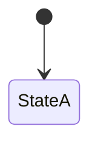

# SPEC-<NNN> — <Short Title>

**Status: draft — awaiting human approval**

> This document is human-gated. It authorizes nothing. No Flutter code, dependency, schema, migration
> or RLS policy may be written until this spec is approved and a `plan/` exists.

| | |
| --- | --- |
| Spec ID | SPEC-<NNN> |
| Derived from | `intent/<intent-file>.md` (Status: <approved + date>) |
| Supersedes | <SPEC-NNN / none> |
| Spec author | analyst |
| Approved by | _pending human_ |

---

## 1. Purpose and scope

One paragraph: what this spec covers, and explicitly what it does not.

**In scope**
- (bullet list)

**Out of scope**
- (bullet list — mirror the intent's Future Phases so implementation cannot drift)

## 2. Terms

Terms come from `docs/glossary.md`. Add only spec-local terms, and mark each as spec-local.
Do **not** edit `docs/glossary.md` from a spec — it is shared vocabulary, not spec-owned.

| Term | Definition |
| --- | --- |
| Example term | Spec-local definition. Not added to the glossary. |

## 3. Actors and permissions summary

One table. Detailed matrix goes in §7.

| Actor | Can | Cannot |
| --- | --- | --- |
| Patient | | |
| Doctor | | |
| Clinic Administrator | | |

## 4. Decisions Register

Every ambiguity the intent left open that this spec had to resolve **explicitly**.
Do not resolve an ambiguity silently — if it is not in this table, it was invented.

| ID | Question left open by intent | Decision | Rationale | Intent line resolved | Affects |
| --- | --- | --- | --- | --- | --- |
| D-01 | | | | §Functional Scope | REQ-* |

**Human approval required:** each `D-nn` needs sign-off. A rejected `D-nn` invalidates the requirements
that reference it — list those explicitly in the final report.

## 5. Requirements

One block per requirement. Use the prefixes in §9.

### <PREFIX>-001 — <Short imperative title>
**Requirement.** The system MUST … (RFC 2119 keywords).

**Acceptance criteria** (each one maps to one test case)
1. **Given** … **When** … **Then** …
2. **Given** … **When** … **Then** …

**Negative cases.** …

**Traces to.** `intent/<file>.md` §<section> — "<verbatim intent line>"

**Decisions.** D-01, D-04

---

## 6. State machines

For each lifecycle (appointment, account, any other):

- Mermaid or ASCII diagram of states and edges
- Transition table: `from → to | guard | allowed roles | side effects`
- Terminal states and who may correct them

## 7. Authorization matrix

Table × role × operation. Enforced database-side; client hiding is never the control.

| Table | Patient | Doctor | Admin |
| --- | --- | --- | --- |
| `example` | SELECT: own rows only | SELECT: own rows only | SELECT/INSERT/UPDATE: all |

Denials must be **tested**, not assumed.

## 8. Non-functional requirements

| ID | Category | Requirement | How verified |
| --- | --- | --- | --- |
| NFR-001 | Performance | | |
| NFR-002 | Accessibility | | |

Cover: performance, responsiveness/breakpoints, accessibility, localization completeness (incl. RTL),
theming, error and offline handling, audit logging, security.

## 9. Requirement ID scheme

| Prefix | Domain |
| --- | --- |
| `AUTH-*` | Authentication, session, accounts |
| `<ACT>-*` | One per actor |
| `SYS-*` | Cross-cutting |
| `NFR-*` | Non-functional |

IDs are **stable**. Never renumber or reuse. Retired IDs stay with a `RETIRED` marker and a pointer
to the superseding ID.

## 10. Traceability matrix

Every intent line maps to requirement IDs, and every requirement maps back to an intent line.
Both directions must be complete — no orphans in either direction.

| Intent section | Intent line | Requirement IDs |
| --- | --- | --- |
| §Functional Scope | | |

| Requirement ID | Intent line | Covered by |
| --- | --- | --- |

## 11. Test strategy

- **Unit** — business logic and pure functions.
- **Widget** — key UI states, localization rendering, both themes.
- **Integration** — RLS policies, DB constraints, concurrency.

State the split and what belongs in each. Note which tests prove the negative cases and the
authorization denials.

## 12. Blocking questions

Unresolved items that block planning for the affected area.

| ID | Question | Blocks | Decision needed from | Needed by |
| --- | --- | --- | --- | --- |
| Q-01 | | | Human | |

## 13. Assumptions log

| ID | Assumption | Why needed | Impact if wrong |
| --- | --- | --- | --- |
| A-01 | | | |

## 14. Risks

| ID | Risk | Likelihood | Impact | Mitigation |
| --- | --- | --- | --- | --- |
| R-01 | | | | |

---

## Definition of Done for this spec

- [ ] Every intent line appears in §10 with no orphan requirements
- [ ] Every ambiguity resolved appears in §4 with rationale and intent line
- [ ] Every acceptance criterion is Given/When/Then and machine-verifiable
- [ ] Every authorization denial has a corresponding planned test
- [ ] Every state machine has a transition table with guards and allowed roles
- [ ] Out-of-scope list mirrors the intent's Future Phases
- [ ] Status left as `draft — awaiting human approval`
